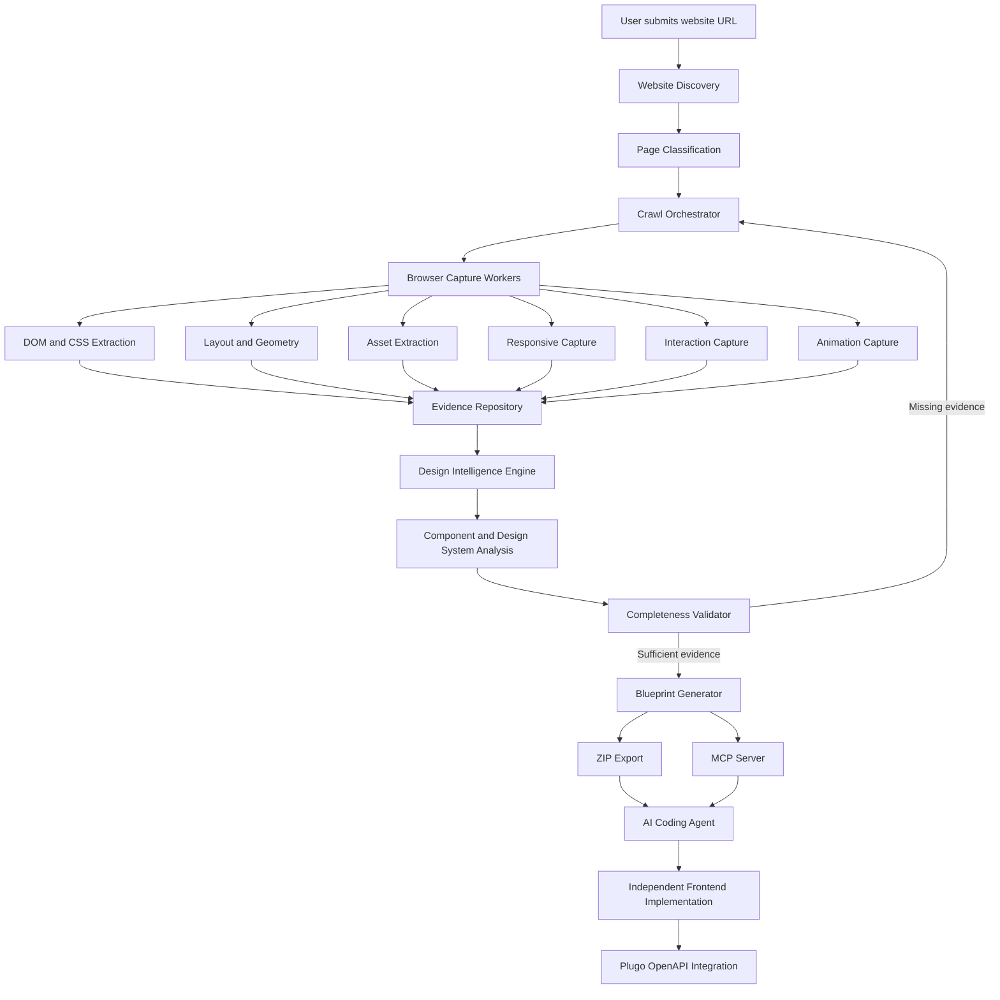
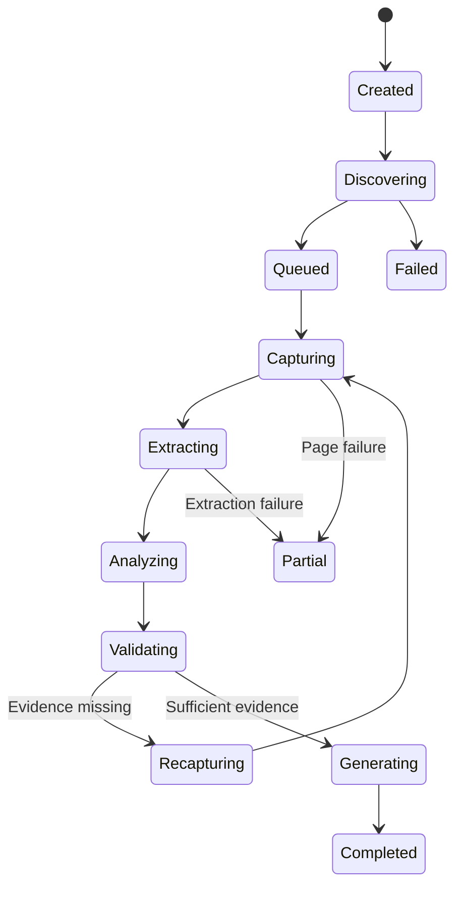

# Website Design Reverse Engineering Engine
## Technical Specification & Implementation Blueprint

**Document type:** Product and Technical Specification  
**Product:** Internal Plugo Engineering Tool  
**Version:** 1.0  
**Status:** Proposed  
**Primary output:** Website Design Blueprint (ZIP) + MCP Server  
**Downstream integration:** Independently developed frontend connected to Plugo OpenAPI

---

# 1. Product Overview

## 1.1 Product vision

Build an engine that can inspect an existing ecommerce website, understand its complete visual design and behavior, and produce sufficiently detailed technical documentation for an AI coding agent to recreate the website with high visual and behavioral fidelity.

The engine should work with websites built using different platforms and technologies, including:

- Shopify.
- WooCommerce.
- Magento.
- Custom React, Next.js, Vue, and other frontend applications.
- Custom HTML/CSS/JavaScript websites.
- Other publicly accessible ecommerce websites.

The engine must not depend on the source website's CMS, framework, theme, or original source code.

Its primary source of truth is the website as rendered in a real browser.

## 1.2 Core workflow

The intended workflow is:

1. A user submits an ecommerce website URL.
2. The engine discovers the website's accessible pages.
3. The engine identifies page types and reusable components.
4. Browser automation captures the website at multiple viewport sizes.
5. The engine extracts DOM, CSS, geometry, typography, assets, responsive behavior, and interactions.
6. AI analyzes the collected evidence and produces a structured design specification.
7. A completeness validator identifies missing or insufficient evidence.
8. The engine recaptures missing evidence when possible.
9. The system generates a Website Design Blueprint ZIP.
10. The MCP server exposes the same blueprint to AI coding agents.
11. The developer uses Cursor, Claude Code, Codex, or another coding agent to recreate the frontend.
12. The developer independently connects the recreated frontend to Plugo OpenAPI for commerce functionality.

## 1.3 Product boundary

The engine is responsible for design intelligence and technical documentation.

| Responsibility | Included |
|---|---|
| Website discovery and crawling | Yes |
| DOM and CSS extraction | Yes |
| Layout and geometry analysis | Yes |
| Design token extraction | Yes |
| Asset discovery and collection | Yes |
| Responsive analysis | Yes |
| Interaction inspection | Yes |
| Animation analysis | Yes |
| Cross-page component identification | Yes |
| AI-generated design documentation | Yes |
| ZIP blueprint generation | Yes |
| MCP server for coding agents | Yes |
| Frontend code generation | No, downstream responsibility |
| Plugo Design Editor compatibility | No |
| Plugo-native editor JSON generation | No |
| Plugo OpenAPI integration | No, downstream responsibility |

**Important:** The engine should not generate a Plugo-specific design format. It should produce technology-neutral design intelligence that can guide an independent frontend implementation.

---

# 2. Product Objectives and Success Metrics

## 2.1 Primary objectives

1. Capture the design of an entire website rather than a single landing page.
2. Preserve sufficient technical evidence to reconstruct the original frontend.
3. Reduce the amount of manual website inspection required from developers.
4. Help AI coding agents understand the original website without relying on screenshots alone.
5. Identify reusable components and design patterns across pages.
6. Provide traceable evidence for extracted design decisions.
7. Make the output accessible through both downloadable documentation and MCP.

## 2.2 Success metrics

| Metric | Definition |
|---|---|
| Page discovery coverage | Discovered eligible pages / known eligible pages in the test scope |
| Evidence completeness | Required evidence captured / required evidence expected |
| Asset capture rate | Successfully captured relevant assets / discovered relevant assets |
| Responsive coverage | Pages inspected at required viewport sizes / eligible pages |
| Interaction coverage | Relevant interaction patterns inspected / identified interaction patterns |
| Blueprint completeness | Required documentation sections successfully generated |
| Visual similarity | Screenshot similarity between original and reconstructed website |
| Developer correction effort | Time spent manually correcting the AI-generated implementation |
| Reconstruction time | Time from blueprint availability to acceptable frontend reproduction |

The engine must distinguish between **evidence captured**, **evidence interpreted**, and **design successfully reproduced**. These are separate outcomes.

A high extraction score must not be presented as proof of high visual similarity.

---

# 3. System Architecture

## 3.1 High-level architecture



## 3.2 Recommended technology stack

| Layer | Recommended technology | Purpose |
|---|---|---|
| Web application | React + TypeScript | Project management and inspection UI |
| Backend API | Node.js + TypeScript | Project, crawl, and blueprint management |
| Browser automation | Playwright | Website rendering and interaction |
| Browser inspection | Chrome DevTools Protocol | Matched CSS, layout, network and browser evidence |
| DOM extraction | Browser JavaScript | Element hierarchy and computed styles |
| Image processing | Sharp | Asset metadata, image processing and comparison |
| Job orchestration | BullMQ + Redis | Crawl and extraction jobs |
| Metadata database | PostgreSQL | Projects, pages, components and extraction results |
| Object storage | S3-compatible storage | Screenshots, assets and raw evidence |
| AI analysis | Multimodal LLM | Semantic interpretation and documentation |
| Visual comparison | Pixelmatch + SSIM | Screenshot comparison |
| Export | Node.js ZIP library | Blueprint package generation |
| Agent interface | MCP SDK | Access to blueprint resources and tools |

The exact stack can be adjusted to Plugo's existing engineering standards.

## 3.3 Core services

### A. Project Management Service

Responsibilities:

- Create and manage inspection projects.
- Store the target website URL.
- Maintain crawl configuration.
- Track project status.
- Store page discovery and extraction progress.
- Manage generated blueprint versions.

### B. Website Discovery Service

Responsibilities:

- Discover internal website pages.
- Read sitemap.xml and robots.txt.
- Inspect internal links.
- Identify canonical URLs.
- Normalize URLs and remove duplicates.
- Identify page types.
- Detect pagination and product/category relationships.
- Maintain the crawl queue.

### C. Browser Inspection Service

Responsibilities:

- Open pages using a real browser.
- Wait for page rendering and font loading.
- Capture screenshots.
- Extract DOM and CSS.
- Capture layout geometry.
- Identify loaded assets.
- Inspect responsive states.
- Trigger supported interactions.
- Record browser metadata and errors.

### D. Evidence Repository

Responsibilities:

- Store raw extraction results.
- Store screenshots and assets.
- Preserve the source URL and capture context.
- Maintain extraction versions.
- Track evidence provenance.
- Allow later AI analysis without repeating browser inspection.

### E. Design Intelligence Engine

Responsibilities:

- Interpret the extracted evidence.
- Identify design tokens.
- Group reusable components.
- Identify page templates.
- Explain visual hierarchy.
- Generate page and component specifications.
- Identify inconsistencies and unknowns.

### F. Completeness Validator

Responsibilities:

- Check required evidence coverage.
- Identify missing page states.
- Identify failed asset downloads.
- Detect insufficient responsive inspection.
- Identify uninspected interaction candidates.
- Trigger targeted recapture when possible.

### G. Blueprint Generator

Responsibilities:

- Generate structured JSON and Markdown.
- Organize assets.
- Produce screenshots and evidence manifests.
- Generate the ZIP package.
- Publish blueprint versions.

### H. MCP Server

Responsibilities:

- Expose project and website design information to AI coding agents.
- Allow agents to retrieve specific pages, components, assets and design tokens.
- Return relevant evidence on demand.
- Avoid requiring an entire website blueprint to be inserted into an agent's context.

---

# 4. Functional Requirements

## 4.1 Website Project Creation

**Feature ID:** WRE-001

Users must be able to create a new website inspection project.

### Inputs

- Project name.
- Website URL.
- Optional website description.
- Optional crawl restrictions.
- Optional maximum page limit.
- Optional authentication configuration for authorized websites.
- Optional browser locale.
- Optional inspection configuration.

### Default behavior

The engine should automatically:

1. Normalize the submitted URL.
2. Check whether the website is accessible.
3. Identify the domain.
4. Inspect sitemap.xml.
5. Inspect robots.txt.
6. Start page discovery.
7. Create the inspection project.

### Acceptance criteria

- Users can submit a valid website URL.
- Invalid or inaccessible websites return meaningful errors.
- Projects receive unique IDs.
- Duplicate URLs can be handled without creating unnecessary duplicate projects.
- Project settings are stored and can be updated.

---

## 4.2 Entire Website Discovery

**Feature ID:** WRE-002

The engine must discover all eligible, accessible pages within the target website.

### Discovery sources

The discovery engine should use multiple sources:

1. sitemap.xml.
2. Sitemap index files.
3. robots.txt sitemap references.
4. Internal navigation links.
5. Footer links.
6. Product and category links.
7. Pagination links.
8. Breadcrumb links.
9. Internal links found in rendered DOM.
10. Other accessible website navigation structures.

### URL normalization

The engine must handle:

- Trailing slashes.
- URL fragments.
- Query parameters.
- Duplicate canonical URLs.
- HTTP/HTTPS redirects.
- Domain aliases.
- Tracking parameters.
- Pagination parameters.
- Product variant parameters.

Do not blindly remove all query parameters. Some parameters may represent distinct pages or meaningful states.

### Page classification

The engine should classify discovered pages into:

| Page type | Examples |
|---|---|
| Homepage | Main landing page |
| Category | Product category listing |
| Subcategory | Nested category |
| Product | Individual product detail |
| Search | Search results |
| Collection | Curated product listing |
| Brand | Brand landing page |
| Campaign | Promotional landing page |
| Content | Blog, article, editorial |
| Static | About, contact, FAQ |
| Cart | Shopping cart |
| Other | Unclassified page |

Classification should use URL patterns, DOM structure, page content, and visual similarity.

### Crawl policy

The system should:

- Crawl only eligible internal URLs by default.
- Avoid infinite URL loops.
- Detect calendar and faceted-navigation traps.
- Respect configured page limits.
- Avoid unnecessary repeated crawling.
- Maintain a crawl depth and discovery source.
- Record skipped pages and reasons.
- Allow manual inclusion or exclusion of pages.

### Entire website does not mean infinite crawling

The product should define an eligible crawl boundary.

By default, the boundary is the submitted website's domain and configured subdomains. External checkout providers, social media, and unrelated domains should not be crawled as part of the same website unless explicitly configured.

### Acceptance criteria

- The system discovers pages from both sitemap and rendered internal links.
- Duplicate URLs are consolidated.
- Page classification is stored.
- The user can inspect the discovered page list.
- Crawl progress and skipped-page reasons are visible.
- The system can resume an interrupted crawl.

---

## 4.3 Browser-Based Static Inspection

**Feature ID:** WRE-003

The browser inspection service must capture the actual rendered website.

### Browser environment

Default capture configuration:

- Chromium.
- Desktop viewport: 1440 × 900.
- Device pixel ratio: 1.
- Locale: configurable.
- Color scheme: light by default.
- Reduced motion: configurable.
- JavaScript enabled.
- Browser metadata recorded.
- Fonts and page resources allowed to finish loading within configured limits.

The capture environment must be recorded because rendering can vary between browsers, locales, sessions, and device pixel ratios.

### DOM extraction

For every inspected page, capture:

- Document structure.
- Element hierarchy.
- Element tag names.
- Element IDs.
- Class names.
- Semantic attributes.
- Text content.
- Link destinations.
- Image references.
- Form structures.
- Visibility.
- Element dimensions.
- Element bounding boxes.
- Scroll positions.
- Relevant ARIA attributes.
- Repeated element patterns.

The extraction should retain the parent-child relationships between elements.

It should also identify repeated structures such as product cards, navigation items, banners, and footer columns.

### CSS extraction

For each relevant element, capture computed styles, including:

**Layout**
- display.
- position.
- top, right, bottom and left.
- width and height.
- min-width and max-width.
- min-height and max-height.
- margin.
- padding.
- box-sizing.
- overflow.
- visibility.

**Flexbox and Grid**
- flex-direction.
- flex-wrap.
- justify-content.
- align-items.
- align-content.
- flex-grow.
- flex-shrink.
- flex-basis.
- grid-template-columns.
- grid-template-rows.
- grid-auto-flow.
- grid-gap and related gap properties.

**Typography**
- font-family.
- font-size.
- font-weight.
- line-height.
- letter-spacing.
- text-align.
- text-transform.
- text-decoration.
- white-space.
- word-break.
- text-overflow.

**Visual appearance**
- color.
- background-color.
- background-image.
- background-position.
- background-size.
- opacity.
- border.
- border-radius.
- box-shadow.
- outline.
- filter.
- backdrop-filter.

**Positioning and layering**
- z-index.
- transform.
- transform-origin.
- isolation.
- stacking context indicators.

**Other**
- cursor.
- pointer-events.
- object-fit.
- object-position.
- aspect-ratio.
- clip-path.
- mask properties.

### CSS provenance

Computed CSS alone is insufficient to fully understand why an element looks the way it does.

Where available, the engine should also capture:

- Original stylesheet URL.
- Matched CSS rules.
- Relevant CSS declarations.
- Selector information.
- Media query conditions.
- CSS variables.
- Inline styles.
- Inherited styles.
- Pseudo-element styles.

Use Chrome DevTools Protocol to inspect matched CSS rules and stylesheet information when accessible.

The engine must distinguish between:

- Computed value.
- Original declaration.
- Inherited value.
- Browser default.
- Unavailable source information.

### Pseudo-elements

Capture styles for:

- `::before`
- `::after`
- `::marker`
- Other relevant pseudo-elements where accessible.

Pseudo-elements can contain important design details such as decorative lines, icons, overlays, and background shapes.

### Acceptance criteria

- DOM hierarchy is retained.
- Computed CSS is captured for relevant elements.
- Geometry is captured.
- Pseudo-elements are inspected.
- CSS provenance is recorded where accessible.
- Extraction failures are reported rather than silently ignored.

---

## 4.4 Layout and Geometry Analysis

**Feature ID:** WRE-004

The engine must translate browser measurements into a layout specification.

Capture:

- Page width.
- Main content width.
- Maximum container width.
- Horizontal alignment.
- Section height.
- Section spacing.
- Element offsets.
- Grid dimensions.
- Column counts.
- Column widths.
- Row and column gaps.
- Overlapping elements.
- Sticky elements.
- Fixed elements.
- Absolute positioning.
- Vertical rhythm.

For each major section, record:

- Bounding box.
- Parent container.
- Child elements.
- Relative position.
- Width and height.
- Alignment.
- Spacing before and after.
- Background and visual treatment.

### Example layout specification

```json
{
  "section": "featured-products",
  "boundingBox": {
    "x": 120,
    "y": 920,
    "width": 1200,
    "height": 680
  },
  "layout": {
    "display": "grid",
    "columns": 4,
    "columnGap": 24,
    "rowGap": 32
  },
  "container": {
    "maxWidth": 1200,
    "horizontalAlignment": "center"
  },
  "evidenceStatus": "measured"
}
```

These values are illustrative. Actual output must come from browser measurements.

---

## 4.5 Typography and Font Intelligence

**Feature ID:** WRE-005

The engine must identify and document the website's typography system.

Capture:

- Font family.
- Font weight.
- Font size.
- Line height.
- Letter spacing.
- Text transform.
- Font style.
- Font source.
- Font format.
- Variable font information where available.
- Fallback font stack.
- Font loading status.

Identify semantic typography roles:

- Display heading.
- H1.
- H2.
- H3.
- Body.
- Caption.
- Button.
- Navigation.
- Price.
- Product title.
- Label.
- Promotional text.

The semantic classification should be AI-assisted, but the underlying font values must be browser evidence.

---

## 4.6 Design Tokens and Design System Extraction

**Feature ID:** WRE-006

The engine must identify global design patterns across the entire website.

### Token categories

| Category | Examples |
|---|---|
| Colors | Primary, secondary, background, text, border, accent |
| Typography | Heading, body, caption, button |
| Spacing | 4px, 8px, 16px, 24px, 32px |
| Radius | Small, medium, large, pill |
| Shadows | Card, dropdown, modal |
| Layout | Container width, grid gaps |
| Breakpoints | Mobile, tablet, desktop |
| Buttons | Primary, secondary, outline |
| Forms | Input height, border, focus state |

### Token extraction logic

The system should:

1. Collect CSS variables.
2. Collect repeated computed values.
3. Identify common values across pages.
4. Cluster visually similar colors where appropriate.
5. Identify typography patterns.
6. Compare repeated spacing values.
7. Group recurring visual treatments.
8. Assign semantic token names.

Example:

```json
{
  "colors": {
    "color-primary": {
      "value": "#222222",
      "status": "measured",
      "sourceCount": 18
    },
    "color-background": {
      "value": "#FFFFFF",
      "status": "measured",
      "sourceCount": 42
    }
  },
  "spacing": {
    "spacing-1": {
      "value": "8px",
      "status": "inferred"
    }
  }
}
```

Token names are semantic interpretations. Raw measured values and source references must remain available.

---

## 4.7 Asset Intelligence and Extraction

**Feature ID:** WRE-007

The engine must identify and collect relevant website assets.

### Supported asset types

- JPEG.
- PNG.
- WebP.
- AVIF.
- SVG.
- GIF.
- WOFF.
- WOFF2.
- TTF.
- OTF.
- MP4 and other supported video formats.
- Other relevant browser-loaded resources.

### Asset discovery sources

- HTML image elements.
- `srcset`.
- `picture` and `source`.
- CSS background images.
- SVG elements.
- External SVG references.
- CSS font-face declarations.
- Video and poster attributes.
- Browser network requests.

### Asset metadata

For each asset, capture:

- Original URL.
- Local stored filename.
- Asset type.
- Natural dimensions.
- Rendered dimensions.
- File size.
- MIME type.
- Source page.
- DOM element reference.
- CSS usage where applicable.
- Image crop and object-position.
- `srcset` variants.
- Download status.
- Duplicate hash.
- License/provenance metadata where known.

### Important requirements

- Trigger lazy-loaded content through controlled scrolling.
- Capture responsive image variants.
- Preserve original image files where permitted.
- Avoid replacing original assets with AI-generated substitutes.
- Identify missing assets and inaccessible URLs.
- Avoid downloading unrelated third-party resources unnecessarily.

The asset manifest must map every local asset to its original source and usage.

---

## 4.8 Responsive Inspection

**Feature ID:** WRE-008

The engine must inspect every eligible page at multiple viewport widths.

### Default viewport matrix

| Device profile | Viewport width | Purpose |
|---|---:|---|
| Mobile S | 360px | Small mobile |
| Mobile M | 390px | Common mobile |
| Mobile L | 430px | Large mobile |
| Tablet | 768px | Tablet |
| Laptop | 1024px | Small desktop |
| Desktop | 1280px | Standard desktop |
| Desktop L | 1440px | Large desktop |
| Desktop XL | 1920px | Wide desktop |

The viewport height can be configured. The system should capture both initial viewport and full-page screenshots where practical.

### Responsive differences

Compare the same page across viewports and identify:

- Changed container widths.
- Changed column counts.
- Reordered elements.
- Hidden elements.
- Different images.
- Different navigation.
- Mobile menu behavior.
- Font-size changes.
- Spacing changes.
- Image aspect-ratio changes.
- Sticky behavior changes.
- Overflow and clipping.

### Breakpoint detection

Do not assume that a website uses standard Bootstrap breakpoints.

Infer breakpoint ranges by testing widths and comparing layout changes.

If a breakpoint is suspected, perform additional captures around that width to narrow the transition.

### Acceptance criteria

- Each eligible page has desktop and mobile evidence.
- Additional configured viewports are captured.
- Responsive differences are documented.
- Missing viewport captures are reported.
- The system does not invent breakpoint values.

---

## 4.9 Interaction Inspection

**Feature ID:** WRE-009

The engine must identify and inspect relevant interactive elements.

### Interaction candidates

- Navigation menus.
- Mega menus.
- Mobile navigation.
- Search boxes.
- Search autocomplete.
- Tabs.
- Accordions.
- Sliders.
- Carousels.
- Product image galleries.
- Product variants.
- Quantity selectors.
- Modals.
- Dropdowns.
- Sticky headers.
- Floating buttons.
- Cookie banners.
- Promotional popups.
- Form validation.
- Hover effects.
- Focus states.

### Interaction capture process

For every identified interaction:

1. Capture the initial state.
2. Identify the interaction target.
3. Trigger a controlled action.
4. Wait for the UI to stabilize.
5. Capture the resulting state.
6. Record the action and state transition.
7. Capture relevant DOM and CSS changes.
8. Record any navigation or network activity.
9. Restore the initial state where possible.

### Interaction specification example

```json
{
  "component": "main-navigation",
  "interaction": "hover",
  "initialState": "closed",
  "action": "hover-navigation-item",
  "resultState": "mega-menu-open",
  "evidence": {
    "screenshot": "interactions/navigation-open.png",
    "domSnapshot": "interactions/navigation-open.json"
  },
  "status": "captured"
}
```

### Important limitations

The system cannot guarantee that every possible JavaScript interaction can be understood automatically.

Some interactions require:

- Login.
- Valid form data.
- Location-specific content.
- User-specific sessions.
- External APIs.
- Payment or checkout actions.
- Human judgment.

The engine must not perform real purchases, submit sensitive data, or bypass access controls. Unsupported interactions should be marked as unknown or requiring manual inspection.

---

## 4.10 Animation and Motion Inspection

**Feature ID:** WRE-010

The engine should inspect animation behavior beyond static screenshots.

Capture:

- CSS transitions.
- CSS keyframes.
- Animation names.
- Duration.
- Delay.
- Timing function.
- Iteration count.
- Direction.
- Fill mode.
- Scroll-triggered animation.
- Hover transitions.
- Transform changes.
- Parallax effects.
- Motion-related JavaScript libraries where identifiable.

### Inspection approach

- Inspect computed animation and transition properties.
- Inspect accessible CSS keyframes.
- Observe relevant elements before and after interaction.
- Capture screenshots at selected animation states.
- Use controlled scrolling for scroll-triggered behavior.
- Record video clips for complex motion where useful and permitted.

The engine should prioritize meaningful interface animations rather than attempting to record every decorative or continuous animation.

---

## 4.11 Cross-Page Component Intelligence

**Feature ID:** WRE-011

The engine must identify shared components and page templates across the entire website.

Examples:

- Header.
- Announcement bar.
- Main navigation.
- Footer.
- Product card.
- Product grid.
- Breadcrumb.
- Product gallery.
- Product information panel.
- Promotional banner.
- Newsletter form.
- Category navigation.

### Component identification

Use a combination of:

- DOM subtree similarity.
- CSS similarity.
- Repeated structure.
- Asset reuse.
- Geometry similarity.
- Text and semantic patterns.
- AI classification.

### Component documentation

For each component, generate:

- Component name.
- Description.
- Pages where it appears.
- DOM structure.
- Visual dimensions.
- Design styles.
- Responsive variants.
- Interactive behavior.
- Relevant assets.
- Differences between instances.
- Evidence references.

The engine should distinguish between a truly shared component and visually similar but independently implemented sections.

---

# 5. Extraction Pipeline and Processing Strategy

## 5.1 Pipeline stages

| Stage | Activity | Output |
|---|---|---|
| 1 | URL validation | Project metadata |
| 2 | Website discovery | URL inventory |
| 3 | Page classification | Page taxonomy |
| 4 | Crawl planning | Inspection queue |
| 5 | Desktop capture | DOM, CSS, screenshots |
| 6 | Asset extraction | Asset manifest and files |
| 7 | Responsive capture | Viewport evidence |
| 8 | Interaction inspection | Interaction states |
| 9 | Animation inspection | Motion evidence |
| 10 | Cross-page analysis | Components and tokens |
| 11 | AI interpretation | Design documentation |
| 12 | Completeness validation | Coverage report |
| 13 | Targeted recapture | Additional evidence |
| 14 | Blueprint generation | ZIP and MCP resources |

## 5.2 Crawl state machine



The system should support:

- Retry.
- Pause.
- Resume.
- Cancel.
- Partial completion.
- Reinspection.
- Blueprint versioning.

A page failure must not automatically fail the entire project.

## 5.3 Capture passes

Use multiple passes instead of trying to capture everything in one browser session.

**Pass 1 — Discovery**
- Sitemap.
- Internal links.
- Page inventory.
- Page classification.

**Pass 2 — Static inspection**
- DOM.
- Computed CSS.
- Geometry.
- Screenshots.
- Assets.

**Pass 3 — Responsive inspection**
- Viewport matrix.
- Responsive changes.
- Breakpoint detection.

**Pass 4 — Interaction inspection**
- Menus.
- Tabs.
- Galleries.
- Accordions.
- Search.
- Other identified controls.

**Pass 5 — Motion inspection**
- Transitions.
- Keyframes.
- Scroll animation.
- Other relevant motion.

**Pass 6 — Cross-page analysis**
- Shared components.
- Design tokens.
- Page templates.
- Repeated patterns.

**Pass 7 — Completeness validation**
- Missing evidence.
- Failed captures.
- Uninspected interactions.
- Targeted recapture.

This approach makes the process easier to scale, debug, and retry.

---

# 6. Evidence and Data Model

## 6.1 Core entities

| Entity | Description |
|---|---|
| Project | Website inspection project |
| CrawlJob | Overall crawling job |
| Page | Discovered website page |
| PageCapture | One browser capture of a page |
| ViewportCapture | Page capture at a particular viewport |
| Element | Extracted DOM element |
| StyleSnapshot | Computed and matched CSS evidence |
| Asset | Discovered website asset |
| Interaction | Interactive behavior and state transitions |
| Component | Identified reusable design component |
| DesignToken | Extracted or inferred design token |
| EvidenceReference | Link between a conclusion and raw evidence |
| Blueprint | Generated output version |

## 6.2 Evidence status

Every important extracted value or design conclusion should include one of these statuses:

| Status | Meaning |
|---|---|
| measured | Directly observed from browser evidence |
| inferred | Derived from one or more observations |
| unknown | Not reliably established |
| unavailable | Could not be accessed or captured |
| not_applicable | Not relevant to the inspected page or component |

Examples:

- Header height measured from bounding box: `measured`.
- Semantic token name `color-primary`: `inferred`.
- Original font source unavailable: `unavailable`.
- Animation behavior not observable: `unknown`.

Never silently convert an inferred value into a measured value.

## 6.3 Evidence provenance

A design conclusion should be traceable to its supporting evidence.

Example:

```json
{
  "property": "header.height",
  "value": "88px",
  "status": "measured",
  "evidence": [
    {
      "page": "/",
      "viewport": "1440x900",
      "captureId": "capture_001",
      "elementId": "element_023",
      "source": "bounding-client-rect"
    }
  ]
}
```

This is essential for debugging incorrect AI interpretations and improving reconstruction quality.

---

# 7. Website Design Blueprint Output

The ZIP package is the portable, complete deliverable.

## 7.1 Proposed directory structure

```text
website-blueprint/
│
├── MASTER.md
├── AGENT_INSTRUCTIONS.md
├── PROJECT_METADATA.json
│
├── design-system/
│   ├── colors.json
│   ├── typography.json
│   ├── spacing.json
│   ├── shadows.json
│   ├── borders.json
│   ├── breakpoints.json
│   ├── containers.json
│   ├── design-tokens.json
│   └── component-patterns.json
│
├── pages/
│   ├── homepage/
│   │   ├── page-spec.md
│   │   ├── structure.json
│   │   ├── layout.json
│   │   ├── styles.json
│   │   ├── responsive.json
│   │   ├── interactions.json
│   │   ├── animations.json
│   │   └── screenshots/
│   │
│   ├── category/
│   │   └── ...
│   │
│   ├── product/
│   │   └── ...
│   │
│   └── other-pages/
│       └── ...
│
├── components/
│   ├── header.md
│   ├── navigation.md
│   ├── hero.md
│   ├── product-card.md
│   ├── product-grid.md
│   ├── product-gallery.md
│   └── footer.md
│
├── assets/
│   ├── images/
│   ├── logos/
│   ├── icons/
│   ├── fonts/
│   ├── videos/
│   └── assets-manifest.json
│
├── interactions/
│   ├── interaction-index.json
│   └── states/
│
├── raw-evidence/
│   ├── rendered-dom/
│   ├── computed-css/
│   ├── matched-css/
│   ├── geometry/
│   ├── network-assets/
│   └── browser-metadata/
│
└── quality/
    ├── coverage-report.json
    ├── missing-evidence.json
    ├── failed-pages.json
    └── extraction-report.md
```

## 7.2 MASTER.md

This is the primary entry point for an AI coding agent.

It should explain:

- What website was inspected.
- How many pages were discovered.
- Which page templates exist.
- Which components are shared.
- What the overall design system looks like.
- Which assets are available.
- Which pages have responsive specifications.
- Which interactions have been captured.
- Which evidence is incomplete.
- How to navigate the ZIP.

It should not attempt to reproduce every page specification in one file.

## 7.3 AGENT_INSTRUCTIONS.md

This file tells the coding agent how to use the blueprint.

Recommended instructions:

1. Read MASTER.md first.
2. Read the global design system.
3. Identify the requested page template.
4. Read that page's specification.
5. Read relevant shared component specifications.
6. Use original assets from the assets directory.
7. Follow measured geometry and typography values.
8. Follow responsive specifications.
9. Implement captured interaction states.
10. Consult raw evidence when documentation is ambiguous.
11. Do not invent missing design details.
12. Preserve unknown or unavailable evidence as explicit implementation decisions requiring review.
13. Build the frontend independently of Plugo's Design Editor.
14. Integrate commerce behavior through Plugo OpenAPI only when separately instructed.

## 7.4 Page specification example

A page specification should document the complete hierarchy and important visual details.

```markdown
# Homepage

## Overview
- Page URL:
- Page type:
- Capture version:
- Evidence completeness:

## Page structure
1. Announcement bar
2. Header
3. Hero
4. Featured categories
5. Featured products
6. Promotional banner
7. Editorial section
8. Newsletter
9. Footer

## Section: Header

### Layout
- Height: [measured value]
- Position: [measured value]
- Sticky: [measured behavior]
- Container width: [measured value]

### Typography
- Navigation font: [measured value]
- Font size: [measured value]
- Font weight: [measured value]

### Visual styling
- Background: [measured value]
- Text color: [measured value]
- Border: [measured value]

### Interactions
- Navigation hover: [captured behavior]
- Mobile menu: [captured behavior]

### Responsive behavior
- Desktop: [evidence]
- Tablet: [evidence]
- Mobile: [evidence]

### Assets
- Logo: [asset reference]

### Evidence
- Screenshot references
- DOM references
- CSS references
```

All placeholder values must be populated from actual evidence or explicitly marked unknown.

---

# 8. MCP Server Specification

## 8.1 Purpose

The MCP server allows AI coding agents to access the blueprint without loading the entire ZIP into their context.

The ZIP remains the portable artifact. MCP provides a queryable interface to the same underlying information.

## 8.2 Recommended MCP resources

| Resource | Description |
|---|---|
| `project://{projectId}/overview` | Project overview and extraction status |
| `project://{projectId}/design-system` | Global design tokens |
| `project://{projectId}/pages` | Page inventory |
| `page://{projectId}/{pageId}/spec` | Full page specification |
| `page://{projectId}/{pageId}/responsive` | Responsive behavior |
| `page://{projectId}/{pageId}/interactions` | Interaction evidence |
| `component://{projectId}/{componentId}` | Component specification |
| `asset://{projectId}/{assetId}` | Asset metadata and location |
| `quality://{projectId}/coverage` | Evidence coverage report |

## 8.3 Recommended MCP tools

### `list_pages`
Returns discovered pages, their page types, and inspection status.

### `get_page_spec`
Returns the detailed specification for a selected page.

### `get_design_system`
Returns global design tokens and typography.

### `get_component_spec`
Returns a shared component's specification.

### `get_asset_manifest`
Returns asset references and metadata.

### `get_interaction_spec`
Returns interaction states and observed behavior.

### `get_responsive_spec`
Returns responsive specifications for a page.

### `search_evidence`
Searches raw evidence for a specific element, CSS property, asset, or pattern.

### `get_screenshot`
Returns the screenshot reference for a page and viewport.

### `get_quality_report`
Returns missing evidence and extraction limitations.

## 8.4 MCP usage example

An AI coding agent should be able to ask:

> Recreate the product detail page. Retrieve the product page specification, global design tokens, product gallery component, and all relevant product assets.

The MCP server should return only the relevant resources.

A second request could retrieve the mobile product page behavior without loading the complete project again.

## 8.5 MCP access controls

- Project-scoped access.
- Read-only access by default.
- Signed or authenticated access tokens.
- Expiring credentials where appropriate.
- No unrestricted access to other projects.
- No execution of arbitrary website JavaScript through MCP.

---

# 9. API Specification

The backend should expose internal APIs for the UI and processing workers.

Suggested endpoints:

| Method | Endpoint | Purpose |
|---|---|---|
| POST | `/api/projects` | Create project |
| GET | `/api/projects` | List projects |
| GET | `/api/projects/{id}` | Get project |
| PATCH | `/api/projects/{id}` | Update project |
| POST | `/api/projects/{id}/discover` | Start discovery |
| GET | `/api/projects/{id}/pages` | List discovered pages |
| POST | `/api/projects/{id}/crawl` | Start or resume crawl |
| GET | `/api/projects/{id}/status` | Get progress |
| GET | `/api/pages/{id}` | Get page details |
| POST | `/api/pages/{id}/recapture` | Recapture page |
| GET | `/api/projects/{id}/evidence` | Browse evidence |
| GET | `/api/projects/{id}/quality` | Get coverage report |
| POST | `/api/projects/{id}/generate` | Generate blueprint |
| GET | `/api/projects/{id}/exports` | List exports |
| GET | `/api/exports/{id}/download` | Download ZIP |

Use asynchronous jobs for long-running operations. API responses should return job IDs and current status rather than keeping HTTP requests open during browser inspection.

---

# 10. Completeness and Quality Validation

## 10.1 Evidence coverage categories

| Category | Example checks |
|---|---|
| Discovery | Eligible pages discovered and classified |
| DOM | Relevant DOM structures captured |
| CSS | Computed and matched styles captured |
| Geometry | Major sections and containers measured |
| Typography | Font and text styles captured |
| Assets | Relevant assets downloaded and mapped |
| Responsive | Required viewport captures completed |
| Interactions | Identified interaction candidates inspected |
| Animations | Relevant motion properties inspected |
| Components | Shared component patterns documented |

## 10.2 Coverage report

Example:

```json
{
  "projectId": "project_001",
  "pagesDiscovered": 86,
  "pagesCaptured": 82,
  "pagesFailed": 4,
  "responsiveCoverage": 0.94,
  "assetCaptureRate": 0.97,
  "interactionCoverage": 0.78,
  "missingEvidence": [
    {
      "page": "/products/example",
      "category": "interaction",
      "description": "Variant selector could not be inspected"
    },
    {
      "page": "/campaign/example",
      "category": "asset",
      "description": "Background image could not be downloaded"
    }
  ]
}
```

These values are illustrative, not expected performance targets.

## 10.3 Validation rules

- A page must not be marked fully inspected if its required captures failed.
- A missing asset must appear in the report.
- An inaccessible interaction must be marked unavailable or unknown.
- Responsive coverage must reflect actual completed captures.
- The system must preserve failed and skipped page records.
- AI-generated documentation must link back to supporting evidence.
- The system must distinguish extraction failure from a website feature that does not exist.

## 10.4 Recapture logic

The completeness validator should create targeted recapture jobs.

Examples:

- Missing mobile screenshot → capture that viewport.
- Font unavailable during capture → retry after font readiness.
- Lazy image missing → scroll to relevant section and retry.
- Menu not inspected → trigger the relevant navigation item.
- Missing product image variant → inspect `srcset` and network resources.

Avoid repeating the entire crawl when only one page or evidence category is incomplete.

---

# 11. User Interface Specification

## 11.1 Project dashboard

Display:

- Project name.
- Target domain.
- Creation date.
- Crawl status.
- Discovered pages.
- Inspected pages.
- Failed pages.
- Asset capture progress.
- Blueprint version.
- ZIP export availability.
- MCP availability.

## 11.2 Page inventory

Provide a searchable table:

| Page | Type | Desktop | Mobile | Interactions | Status |
|---|---|---|---|---|---|
| `/` | Homepage | Complete | Complete | Partial | Complete with gaps |
| `/collections/shoes` | Category | Complete | Complete | Complete | Complete |
| `/products/shoe-a` | Product | Complete | Pending | Partial | In progress |

The UI should allow users to:

- Open the original page.
- View captured screenshots.
- Inspect extracted structure.
- View missing evidence.
- Retry a page.
- Exclude a page.
- View related components.

## 11.3 Visual evidence viewer

A useful interface should provide:

- Original screenshot.
- Full-page screenshot.
- Viewport screenshot.
- DOM tree.
- Selected element details.
- Computed CSS.
- Geometry.
- Related assets.
- Responsive comparisons.
- Interaction states.

Selecting an element in the screenshot should ideally reveal its DOM node and extracted style evidence.

## 11.4 Export screen

Provide two outputs:

**ZIP Export**
- Blueprint version.
- File size.
- Generation timestamp.
- Completeness report.
- Download action.

**MCP Access**
- MCP endpoint or connection configuration.
- Authentication information.
- Project identifier.
- Setup instructions for supported coding agents.

MCP access must only be shown after successful publication and credential provisioning.

---

# 12. Non-Functional Requirements

## 12.1 Performance

- Browser workers must run independently of the main application API.
- Crawling must support concurrency limits.
- Users must be able to pause and resume jobs.
- Browser crashes must not corrupt the entire project.
- Large assets must be streamed to storage.
- Extraction results should be stored incrementally.

## 12.2 Scalability

The architecture should support:

- Multiple concurrent projects.
- Multiple browser workers.
- Per-domain concurrency limits.
- Queue prioritization.
- Retry policies.
- Separate storage for raw evidence and generated artifacts.

## 12.3 Reliability

- Every capture should have a unique identifier.
- Jobs should be idempotent where possible.
- Failed operations should be retryable.
- Extraction logs should be retained.
- Partial project results should remain accessible.
- Blueprint versions should be immutable after publication.

## 12.4 Security and compliance

- Respect website access restrictions and applicable terms.
- Do not bypass authentication, anti-bot controls, or access restrictions.
- Only use authenticated sessions when the user is authorized to access the website.
- Do not submit purchases or sensitive forms.
- Avoid collecting personal information that is not needed for design inspection.
- Store credentials securely if authorized authenticated capture is supported.
- Restrict browser workers from accessing internal infrastructure and private network resources to prevent SSRF.
- Sanitize extracted content before displaying or passing it to AI.
- Treat website text and scripts as untrusted input.
- Preserve asset source and provenance.
- Respect copyright, intellectual property, and asset licensing requirements.

---

# 13. AI Design Intelligence Specification

## 13.1 AI responsibilities

AI should be responsible for interpreting evidence, not replacing deterministic browser extraction.

Appropriate AI tasks:

- Semantic page classification.
- Component naming.
- Reusable component grouping.
- Design token naming.
- Visual hierarchy explanation.
- Page specification writing.
- Responsive behavior explanation.
- Identifying likely interaction patterns.
- Explaining inconsistencies.
- Generating coding-agent instructions.
- Identifying gaps that require human review.

## 13.2 Tasks that should remain deterministic

- DOM capture.
- CSS computed values.
- Bounding boxes.
- Screenshot capture.
- Asset URLs.
- Image dimensions.
- Browser viewport.
- Network response metadata.
- Actual observed interaction state.
- Capture timestamps.

## 13.3 AI evidence constraints

Every AI-generated technical claim should be supported by evidence where possible.

Examples:

- "The header is sticky" requires observed scroll behavior or reliable browser evidence.
- "The page uses a four-column product grid" requires measured layout evidence.
- "The website uses a primary font" requires font evidence.
- "The product gallery supports thumbnails" requires observed controls or DOM evidence.

When evidence is insufficient, the AI must use `unknown`, `inferred`, or `unavailable` as appropriate.

## 13.4 Context management

Do not send all raw DOM and CSS from an entire website to the LLM in one request.

Instead:

1. Store raw evidence.
2. Create compact page summaries.
3. Group related pages.
4. Analyze shared components.
5. Generate page-level specifications.
6. Retrieve detailed evidence only when required.
7. Validate generated documentation against the evidence repository.

This reduces token usage and makes analysis more manageable.

---

# 14. Testing Strategy

## 14.1 Test website selection

Validate the engine against three different website profiles:

| Test site | Purpose |
|---|---|
| Simple Shopify store | Validate standard ecommerce layouts |
| Customized WooCommerce store | Validate variation in CMS and theme implementations |
| Complex fashion/lifestyle store | Validate advanced visuals, responsive behavior and interactions |

Use authorized test websites or websites for which the team has permission to inspect and use the assets.

## 14.2 Comparison experiment

Compare three approaches:

1. Step1.dev.
2. The proposed Website Design Reverse Engineering Engine.
3. Manual browser inspection by a developer.

Feed the resulting documentation to the same AI coding agent, with the same frontend stack and comparable implementation instructions.

Evaluate:

- Layout accuracy.
- Typography accuracy.
- Image and asset accuracy.
- Responsive accuracy.
- Interaction accuracy.
- Shared component accuracy.
- Screenshot similarity.
- Manual correction time.

The goal is not to prove that the new engine extracts more data. The goal is to demonstrate that it produces a better reconstructed website with less manual correction.

## 14.3 Regression tests

Create fixed test pages with known:

- DOM structures.
- CSS values.
- Responsive breakpoints.
- Assets.
- Fonts.
- Interaction states.
- Animation properties.

Run the extraction engine against them after every significant change.

---

# 15. Implementation Roadmap

The project should be developed in stages. The full product should not be treated as a small screenshot-to-code utility.

## Phase 1 — Core Website Inspector

<ins>Objective:</ins> Build reliable deterministic browser extraction.

Deliverables:

- Project creation.
- URL validation.
- Sitemap and internal-link discovery.
- Page classification.
- Playwright browser workers.
- Desktop screenshots.
- DOM extraction.
- Computed CSS extraction.
- Geometry extraction.
- Asset discovery and download.
- Raw evidence storage.
- Basic page inventory UI.

**Exit criteria:** The engine can discover and inspect pages from different ecommerce platforms and store traceable browser evidence.

## Phase 2 — Deep Design Extraction

<ins>Objective:</ins> Extract detailed design and responsive information.

Deliverables:

- Matched CSS and stylesheet provenance.
- Pseudo-element inspection.
- Typography extraction.
- Design token extraction.
- Multiple viewport capture.
- Responsive comparison.
- Lazy-loaded asset capture.
- Asset manifest.
- Page layout specifications.

**Exit criteria:** The system can generate a detailed technical description of the visual design for each inspected page.

## Phase 3 — Interaction and Component Intelligence

<ins>Objective:</ins> Understand how the website behaves and identify shared design patterns.

Deliverables:

- Interaction candidate detection.
- Controlled interaction capture.
- Before-and-after state documentation.
- Animation analysis.
- Cross-page component grouping.
- Page template identification.
- Shared design system analysis.

**Exit criteria:** The system can document important reusable components and their observed behavior.

## Phase 4 — AI Blueprint Generation

<ins>Objective:</ins> Convert evidence into implementation-ready documentation.

Deliverables:

- AI design analysis.
- Page specifications.
- Component specifications.
- Global design system.
- Agent instructions.
- Evidence provenance.
- Completeness validator.
- Targeted recapture.
- ZIP generation.

**Exit criteria:** A developer can use the ZIP to instruct an AI coding agent to recreate the inspected website.

## Phase 5 — MCP Integration

<ins>Objective:</ins> Make the blueprint directly accessible to coding agents.

Deliverables:

- MCP server.
- Project-scoped resources.
- Page and component retrieval tools.
- Asset manifest retrieval.
- Evidence search.
- Screenshot access.
- Quality report access.
- Authentication and access control.

**Exit criteria:** A coding agent can retrieve the required website design evidence without manually uploading the ZIP.

## Phase 6 — Reconstruction Quality Loop

<ins>Objective:</ins> Improve the quality of the reconstructed frontend.

Deliverables:

- Original-versus-reconstructed screenshot comparison.
- Visual difference reporting.
- Component-level comparison.
- Responsive comparison.
- Design discrepancy identification.
- Suggested correction list.

**Exit criteria:** Developers can systematically identify and correct visual differences between the original website and the reconstruction.

---

# 16. Suggested Engineering Breakdown

The following is a suggested initial work breakdown, not a final sprint estimate.

| Epic | Scope | Priority |
|---|---|---|
| E01 — Project Management | Projects, configuration, status | P0 |
| E02 — Website Discovery | Sitemap, crawling, URL normalization | P0 |
| E03 — Browser Automation | Playwright workers, capture lifecycle | P0 |
| E04 — DOM and CSS Extraction | DOM, computed styles, geometry | P0 |
| E05 — Asset Intelligence | Image, SVG, font and asset manifest | P0 |
| E06 — Responsive Inspection | Viewport matrix and responsive deltas | P0 |
| E07 — Design System Extraction | Colors, typography, spacing and tokens | P0 |
| E08 — Blueprint Generator | Page specs, documentation and ZIP | P0 |
| E09 — Interaction Inspection | Menus, galleries, forms and UI states | P1 |
| E10 — Component Intelligence | Shared components and templates | P1 |
| E11 — Animation Inspection | Transitions, keyframes and motion | P1 |
| E12 — Completeness Validator | Coverage, gaps and recapture | P1 |
| E13 — MCP Server | Resources, tools and authentication | P1 |
| E14 — Visual Comparison | Screenshot comparison and discrepancy reports | P2 |

P0 represents the minimum viable high-fidelity blueprint engine. Deep interaction inspection and MCP should follow once the evidence repository and extraction contracts are stable.

---

# 17. Indicative Team and Timeline

A realistic initial implementation team could include:

| Role | Suggested allocation |
|---|---:|
| Product Manager | 0.5–1 |
| Technical Lead / Backend Engineer | 1 |
| Browser Automation Engineer | 1 |
| Frontend Engineer | 1 |
| AI / Backend Engineer | 1 |
| QA Engineer | 0.5–1 |

### Indicative delivery estimates

| Milestone | Estimated duration |
|---|---:|
| Core Inspector | 3–4 weeks |
| Deep Design Extraction | 2–3 weeks |
| Interaction and Component Intelligence | 2–3 weeks |
| AI Blueprint and ZIP | 2 weeks |
| MCP Integration | 1–2 weeks |
| Quality testing and hardening | 1–2 weeks |

**Overall planning estimate: approximately 11–16 weeks** for a production-oriented first version, assuming a team of roughly 4–6 contributors and reuse of established browser automation and MCP libraries.

This is a planning estimate, not a commitment. Complex websites, authentication, browser limitations, and the quality of the interaction inspection layer can materially change the schedule.

---

# 18. MVP Scope and Release Criteria

The first release should prioritize a reliable, detailed design blueprint over advanced AI features.

### P0 — Required for first release

- [ ] Create inspection project from URL.
- [ ] Discover the entire eligible website.
- [ ] Classify page types.
- [ ] Capture desktop and mobile pages.
- [ ] Extract DOM hierarchy.
- [ ] Extract computed CSS.
- [ ] Capture layout geometry.
- [ ] Extract images, SVGs, logos and fonts.
- [ ] Extract typography and color tokens.
- [ ] Generate page-level specifications.
- [ ] Generate global design system documentation.
- [ ] Generate asset manifest.
- [ ] Generate completeness report.
- [ ] Export structured ZIP.
- [ ] Include AI coding-agent instructions.

### P1 — Deep inspection capabilities

- [ ] Additional viewport sizes.
- [ ] Matched CSS rule extraction.
- [ ] Pseudo-element extraction.
- [ ] Interaction state inspection.
- [ ] Animation inspection.
- [ ] Cross-page component detection.
- [ ] Targeted recapture.
- [ ] MCP server.
- [ ] Evidence search.

### P2 — Advanced capabilities

- [ ] Screenshot visual similarity scoring.
- [ ] Reconstruction discrepancy analysis.
- [ ] Advanced canvas and WebGL inspection.
- [ ] More advanced dynamic interaction exploration.
- [ ] Automated implementation feedback loop.

### Release acceptance criteria

The first release is acceptable when:

1. A user can submit an eligible ecommerce website URL.
2. The engine can discover and classify its accessible pages.
3. The engine captures desktop and mobile design evidence.
4. Relevant DOM, CSS, geometry, and assets are retained.
5. Design tokens and page specifications are generated from evidence.
6. The system identifies missing or unavailable evidence.
7. The ZIP is usable by an AI coding agent without requiring Plugo Design Editor compatibility.
8. A developer can use the blueprint to recreate a representative page with materially less manual inspection than a screenshot-only workflow.

MCP can be released as the next milestone once the blueprint schema and retrieval contracts are stable.

---

# 19. Key Technical Risks and Mitigations

| Risk | Impact | Mitigation |
|---|---|---|
| Dynamic websites | Incomplete or inconsistent captures | Wait for stable rendering; capture controlled states |
| Lazy-loaded assets | Missing images | Scroll through pages and inspect network resources |
| CSS-in-JS | Difficult stylesheet provenance | Capture computed styles and available CDP evidence |
| Complex animations | Incomplete motion analysis | Record targeted animation states and video evidence |
| Authentication | Restricted page coverage | Support authorized session capture |
| Anti-bot restrictions | Crawl failures | Respect restrictions; do not bypass controls |
| Large websites | Excessive crawl time and cost | Queue limits, page prioritization and incremental capture |
| AI hallucination | Incorrect design specifications | Evidence references, confidence and status labels |
| Duplicate components | Incorrect design system | Combine structural, visual and contextual evidence |
| Asset licensing | Inappropriate asset reuse | Preserve source and usage provenance |
| Incomplete responsive evidence | Poor mobile reconstruction | Required viewport matrix and coverage validation |

---

# 20. Final Product Recommendation

The most important architectural decision is to maintain a strict separation between three layers:

**Layer 1 — Website Inspector**

Captures what the browser actually renders and does. This layer should be deterministic, repeatable, and evidence-oriented.

**Layer 2 — Design Intelligence Engine**

Interprets the captured evidence and turns it into a structured design system, page specifications, reusable component documentation, and implementation instructions.

**Layer 3 — AI Coding Agent Interface**

Provides the blueprint through ZIP and MCP so developers can recreate the frontend using their preferred tools and framework.

This architecture avoids the main weakness of screenshot-only or shallow website extraction: the coding agent is no longer expected to guess the original website's layout, CSS, assets, responsive behavior, and interactions from a few screenshots.

The engine should be judged by one central question:

**Can a developer use its output to recreate the original website accurately, with substantially less manual inspection and correction?**

That should be the product's primary measure of success—not the number of pages crawled, the number of CSS properties extracted, or the size of the generated ZIP.